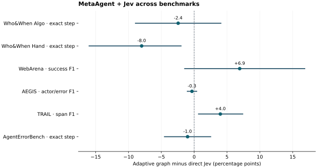

# AutoJudge with MetaAgent and Jev judges

This experiment tests whether a trace-specific panel of Jev judges improves on direct Jev and how replacing the LLM judges changes AutoJudge. A generative MetaAgent reads each trace and the benchmark rubric, then writes six specialist questions. Jev 1.14 executes the specialists in parallel. The final Jev judge for each evaluation target sees the trace and the specialists' findings and produces a typed verdict.

```text
Benchmark trace + evaluation spec
  → Gemini 2.5 Flash MetaAgent
  → six Jev 1.14 specialists
  → Jev 1.14 final verdict per target
  → scorer compares the verdict with the separate reference
```

Python builds the allowed answers from the trace and the evaluation spec. For example, Who&When chooses one message and projects it to both the agent and the step. AEGIS checks pairs of trace actors and error categories. MetaAgent and the judges receive the evidence and rubric. The reference labels enter at scoring.

## Cross-benchmark results

We ran the adaptive graph and direct Jev on the same 1,198 traces from five benchmarks. Direct Jev applies the same final target questions to the trace with an empty specialist context. Both arms used Jev `typesafe/jev-1.14-20261014`. The graph used Gemini 2.5 Flash through OmniRoute for per-trace planning.

| Benchmark | Traces | Primary metric | MetaAgent + Jev | Direct Jev | Paired difference, pp [95% CI] | Median time, graph / direct |
| --- | ---: | --- | ---: | ---: | --- | ---: |
| TRAIL | 148 | Span localization F1 | **30.24%** | 26.25% | **+3.99 [+0.66, +7.39]** | 9.25 / 0.61 s |
| WebArena | 78 | Success F1 | **90.57%** | 83.64% | +6.93 [−1.44, +16.84] | 3.74 / 0.28 s |
| AEGIS | 600 | Actor–error pair F1 | 12.41% | 12.75% | −0.34 [−1.04, +0.38] | 8.16 / 1.25 s |
| AgentErrorBench | 199 | Exact step | 19.10% | 20.10% | −1.01 [−4.52, +2.51] | 6.65 / 0.47 s |
| Who&When Algo | 123 | Exact step | 44.72% | 47.15% | −2.44 [−8.94, +4.07] | 3.57 / 0.25 s |
| Who&When Hand | 50 | Exact step | 12.00% | 20.00% | −8.00 [−16.00, −2.00] | 5.28 / 0.40 s |

The graph found more correct error spans on TRAIL, 1.03 per trace versus 0.77. On WebArena it produced one false successful verdict versus four for direct Jev. The graph was slower on every cohort. The intervals come from 10,000 paired trace resamples of one run and have no multiple-comparison correction. Three non-OK graph results and one direct result stay in the denominators. Jev receipts totaled $12.18 for the graph and $1.89 for direct Jev. This excludes the MetaAgent charges and unpriced attempts.



See the [machine-readable summary](results/adaptive-2026-11-25/metrics.json), [case selection lists](results/adaptive-2026-11-25/), and [data provenance](results/adaptive-2026-11-25/PROVENANCE.md).

### Separate comparison with the LLM graph

The original [Who&When runner](../who_and_when/run_jev.py) also compared **AutoJudge with LLM judges** against **AutoJudge with Jev judges**, both with a generative MetaAgent and six specialists. On all 126 Algo traces the Jev graph returned 56 exact steps (44.44%) versus 54 (42.86%) for the LLM graph. The paired difference was +1.59 pp, 95% CI [−7.14, +10.32]. Median latency was 4.84 s versus 20.56 s. Mean cost on 122 jointly priced traces was $0.00399 versus $0.02014 per trace, using nominal token-rate estimates for chat. Each graph generated its own plan. The comparison therefore includes changes to the judge model and its question and answer formats.

## Run the adaptive graph

From the repository root, install the benchmark dependencies with `uv sync --group benchmarks` and configure the endpoints using [`.env.template`](../../.env.template). The reported runs used `OMNIROUTE_BASE_URL` and `OMNIROUTE_API_KEY` for MetaAgent chat and `OPENROUTER_DECISIONS_URL` and `OPENROUTER_API_KEY` for Jev. Use the model identifier understood by your chat endpoint.

For example, export an AEGIS test JSONL and run a two-trace smoke test:

```bash
uv run --group benchmarks python examples/aegis/auto_judge_launch_aegis_no_summaries.py \
  --jev-export /path/to/test.jsonl --output-dir /tmp/jev-aegis-input

uv run --group benchmarks python examples/jev/run_experiment.py \
  --cases /tmp/jev-aegis-input/cases.jsonl \
  --references /tmp/jev-aegis-input/references.jsonl \
  --spec examples/jev/specs/aegis.json --primary-metric actor_error_f1 \
  --modes adaptive direct --specialist-count 6 \
  --meta-model openrouter/google/gemini-2.5-flash \
  --max-attempts 4 --max-concurrent-requests 3 \
  --limit 2 --output-dir /tmp/jev-aegis-smoke
```

Remove `--limit 2` for a full run and choose a fresh output directory. Pass `--validate-only` to check a dataset and spec before opening a model connection. The runner writes a manifest, one result per case and mode, and a summary. Repeat the same command with `--resume` to continue an interrupted run.

| Benchmark | Input preparation | Spec |
| --- | --- | --- |
| Who&When | [Parquet or JSONL converter](convert_who_and_when.py). For the reported cohorts, filter original rows to the published IDs before converting. | [who_and_when.json](specs/who_and_when.json) |
| WebArena | [Download and clean](../agent-reward-bench/prepare_webarena_data.py), then [convert the selected cleaned JSON traces and annotations CSV](convert_webarena.py). | [webarena.json](specs/webarena.json) |
| AEGIS | [Existing launcher in export mode](../aegis/auto_judge_launch_aegis_no_summaries.py). | [aegis.json](specs/aegis.json) |
| TRAIL | [Convert the official trace and annotation directories](convert_trail.py). Long span fields are compacted in both modes. | [trail.json](specs/trail.json) |
| AgentErrorBench | [Join trace JSON and labels by trajectory ID](convert_agent_error.py). Long messages are compacted in both modes. | [agent_error_bench.json](specs/agent_error_bench.json) |
| Pumpkin | The spec exists. A matched set of execution traces and independent human labels was unavailable for this run. | [pumpkin.json](specs/pumpkin.json) |

The paired results use all 600 AEGIS and 148 TRAIL cases, one eligible singly annotated trace for each of 78 official WebArena test tasks, 199/200 AgentErrorBench traces, and 173/184 Who&When traces. Who&When exclusions have unreachable agent–step references. The one AgentErrorBench exclusion has an annotated step beyond the trace. TRAIL measures span localization; two annotations without span IDs are omitted.

## Code map

- [Experiment runner](run_experiment.py) handles case selection, modes, resume, and per-case logging.
- [MetaAgent planner](../../src/autojudge/jev/planner.py) generates and validates the specialist plan.
- [Jev evaluator](../../src/autojudge/jev/engine.py) executes the two levels of the graph and assembles typed answers.
- [Decisions client](../../src/autojudge/jev/client.py) submits requests and records retries and usage.
- [Scorer](../../src/autojudge/jev/scoring.py) projects the verdict into benchmark labels and computes metrics.
- [Protocol](../../docs/JEV_EXPERIMENT.md) describes the input contract, commands for other benchmarks, and reporting details.
